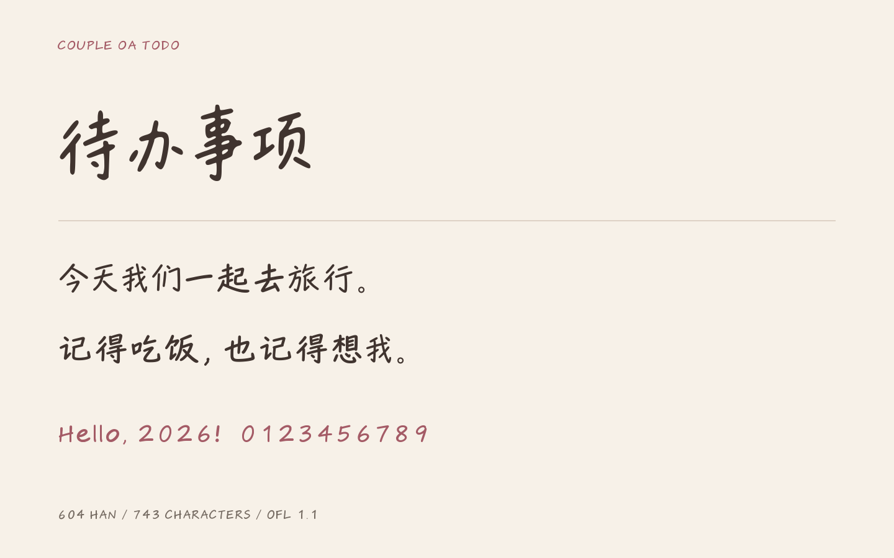

# 两人待办手写体 · Couple OA Todo

一款从「待办事项」出发的手写展示字体，适合日常标题、手账和短句。保留笔画的不规则感与自然字宽。



**首个开源版本 v0.1.0：604 个汉字 + 139 个英文、数字、标点与空格，共 743 个字符。**

[下载字体](https://github.com/georgehuang000/couple-oa-todo-font/releases/latest) · [在线试字](https://georgehuang000.github.io/couple-oa-todo-font/) · [全部字符](data/characters.txt) · [授权](OFL.txt)

## 下载与使用

- **安装到电脑**：下载 `CoupleOATodo-Regular.ttf`，双击安装，字体菜单中选择 **Couple OA Todo**。
- **用于网页**：下载 `CoupleOATodo-Regular.woff`，参考下面的 CSS。
- **查看和修改源码**：克隆本仓库。`sources/ttx/` 是可编译的逐字轮廓母版，`sources/svg/` 是可查看、编辑的单字 SVG。

```css
@font-face {
  font-family: "Couple OA Todo";
  src: url("./fonts/CoupleOATodo-Regular.woff") format("woff");
  font-weight: 400;
  font-style: normal;
  font-display: swap;
}
.handwritten-title {
  font-family: "Couple OA Todo", sans-serif;
  font-weight: 400;
  font-synthesis: none;
  line-height: 1.55;
}
```

建议从 24–48 px 的标题和短句开始试用。字重为 Regular，中文使用自然比例字宽，数字等宽。小字号的长文、重要输入内容请保留清晰的系统字体回退。

这是设计母版版本，**不包含完整的 8105 字通用规范汉字表**。未收录的文字由系统字体显示；试字页会明确列出缺字。不要把系统回退误认为本字体已经收录。

## 许可

字体文件、TTX / SVG 字形源码与本项目文档采用 **SIL Open Font License 1.1（OFL-1.1）**。可用于商业设计、网站和应用，可修改并再分发；随字体保留版权和许可证，字体及衍生字体继续采用 OFL，不能单独售卖字体。用字体排版产生的作品不要求采用 OFL。未设置 Reserved Font Name。完整条件见 [OFL.txt](OFL.txt)。

`scripts/`、预览页 HTML / CSS / JavaScript 和 CI 配置采用 [MIT](licenses/MIT.txt)。它们的许可不改变字形源码的 OFL。字体采用 AI 辅助设计；来源和制作边界见 [PROVENANCE.md](docs/PROVENANCE.md)。

## 离线构建

使用已有的独立 Python 3.10+ / Conda 环境；缺少依赖时再新建环境，避免向 Conda base 安装。构建只依赖 fontTools，不调用模型或图像服务。

```sh
python -m pip install -r requirements.txt
python scripts/build.py
python scripts/verify.py
```

字体写入 `dist/fonts/`。`verify.py` 核对 743 个字符、空格、数字字宽、许可元数据、TTF / WOFF 一致性，以及从 TTX 离线重建 TTF 的逐字节一致性。WOFF 同时核对字体表内容；不同 zlib 版本的压缩字节可能不同。

```sh
# 本地试字
python -m http.server 8000 --bind 127.0.0.1
```

在浏览器打开 `http://127.0.0.1:8000/`。页面不上传输入文字，不使用分析服务。

修改字符清单后，运行 `python scripts/web-data.py` 更新预览数据。`python scripts/specimen.py` 可重画样张及全部字符检查图，需要 `requirements-dev.txt` 中的 Pillow。安装包不包含完整字形源码；离线构建请下载 source 包或克隆仓库。

## 制作和后续计划

原始设计图经项目所有者确认来自本人设计或 AI 生成并允许公开。8 个字来自这些设计图，其余图像字形经生成、校对、轮廓追踪和间距调整制作；另有原生矢量符号。这个版本保留原版 731 个字符，补上 12 个自主绘制的括号，不包含 MX-Font 扩字结果。

完整扩字实验曾使用 Windows 宋体结构输入，因此没有将该实验版本作为开放授权字体发布。后续需要替换扩字素材来源，并重新检查字形与许可。详见 [制作记录](docs/PROCESS.md) 和 [路线图](docs/ROADMAP.md)。

发现缺字、错字或间距问题，请按 [贡献说明](CONTRIBUTING.md) 提交 Issue。覆盖率和自动检查通过不代表专业字库审校认证。
