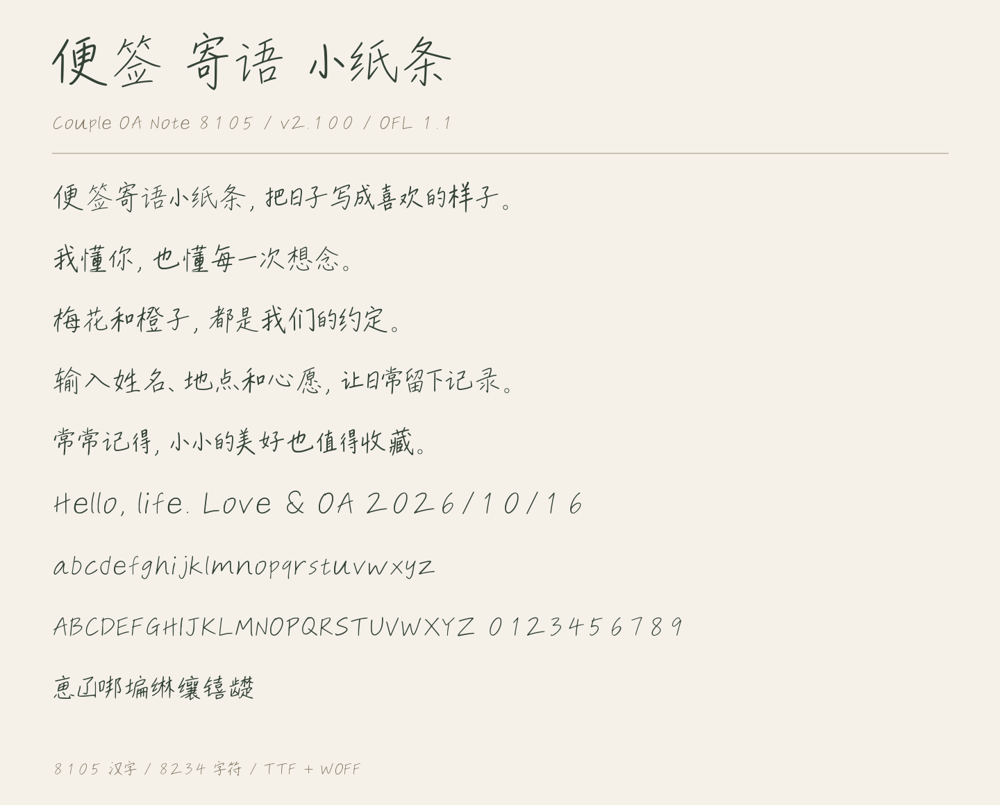

# 两人手写字体 · Couple OA Fonts

把待办、便签、寄语和小纸条写成可编辑的文字。本项目一起维护两套手写字体，各自保留字形、覆盖范围和版本，均提供 TTF、WOFF 与可修改的字形源码。

| 字体 | 适合的场景 | 当前覆盖 | 使用与源码 | 下载 | 在线试字 |
| --- | --- | --- | --- | --- | --- |
| **两人待办手写体 · Couple OA Todo** | 标题、手账、短句 | **604 汉字 / 743 字符** | [说明](README.todo.md) | [v0.1.0](https://github.com/georgehuang000/couple-oa-todo-font/releases/tag/v0.1.0) | [试字](https://georgehuang000.github.io/couple-oa-todo-font/) |
| **便签手记 · Couple OA Note 8105** | 便签、寄语、小纸条 | **8105 汉字 / 8234 字符** | [说明](note/README.md) | [2.100](https://github.com/georgehuang000/couple-oa-todo-font/releases/tag/note-v2.100) | [试字](https://georgehuang000.github.io/couple-oa-todo-font/note/) |

下载对应的 TTF，双击安装后在软件中选择 **Couple OA Todo** 或 **Couple OA Note 8105**，即可修改文案、字号与颜色。下载包也包含离线试字页；未收录字符会明确提示。两套字体是不同的设计，不互相替换。




## 许可与来源

两套字体和字形母版均采用 **SIL Open Font License 1.1**，允许按许可商用、嵌入、修改及再分发。随字体保留版权和许可，修改版字体继续采用 OFL，字体本身不能单独出售。

- 待办手写体：[OFL](OFL.txt)、[来源](docs/PROVENANCE.md)、[制作过程](docs/PROCESS.md)。
- 便签手记：[OFL 与 Adobe 上游版权](note/OFL.txt)、[来源](note/PROVENANCE.md)、[检查范围](note/qa/review.json)。
- 待办构建与页面工具：[MIT](licenses/MIT.txt)；便签独立工具：[MIT](note/LICENSE-CODE)。第三方声明随各字体保留。

便签手记覆盖 8105 规范汉字，不代表包含所有繁体字或 Unicode。待办手写体仍是 604 汉字设计母版；它的历史 8105 字实验未发布。两套字体的来源和验收分别记录，字数与工程检查不能代替专业逐字审校。

## 开发与反馈

保持原有待办路径，便签字体放在 `note/`。两套字体都可从 TTX 母版离线重建，不需要原应用、模型或系统字库。建议使用独立的 Python 3.10+ / Conda 环境。

```sh
# 待办手写体，在项目根目录执行
python -m pip install -r requirements.txt
python scripts/build.py
python scripts/verify.py

# 便签手记
cd note
python -m pip install -r requirements.txt
python tools/build.py
python tools/verify.py --fonts build/fonts --compare-release
```

修改字形或反馈问题，请说明**字体名称、字符、版本、软件和字号**，参见[待办贡献说明](CONTRIBUTING.md)与[便签贡献说明](note/CONTRIBUTING.md)。合并发布过程及取舍见[项目维护记录](docs/COLLECTION.md)。
